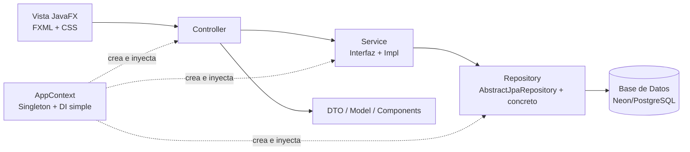
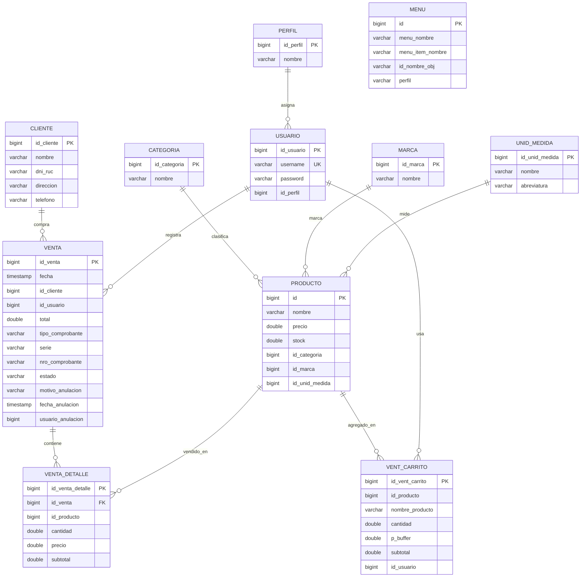

# Sys.Ventas — Explicación completa del proyecto, arquitectura, paneles y POO

> **Proyecto:** `Sys.Ventas` (JavaFX + Maven)  
> **Paquete base:** `pe.edu.upeu`  
> **BD configurada:** PostgreSQL/Neon (`application.properties` → `schema_neon.sql`)  
> **Esquemas disponibles:** `schema_neon.sql` (PostgreSQL), `schema.sql` (H2), `crear.sql` (legacy).

---

## 1) Resumen del proyecto

**Sys.Ventas** es un sistema de escritorio para gestión de ventas de ropa/retail. Permite:

- Iniciar sesión con usuarios y perfiles (Administrador/Vendedor).
- Gestionar catálogos: productos, categorías, marcas, unidades de medida.
- Gestionar clientes (DNI/RUC, dirección, teléfono).
- Registrar ventas en un POS/carrito, descontar stock y generar comprobante.
- Visualizar/exportar/imprimir comprobantes (vista previa + PDF).
- Anular/eliminar ventas y restaurar stock cuando corresponde.
- Administrar usuarios (perfil administrador).

El sistema sigue una arquitectura por capas:



---

## 2) Estructura del proyecto (qué hay y para qué)

| Ruta | Responsabilidad |
|---|---|
| `src/main/java/pe/edu/upeu/App.java` | Punto de entrada JavaFX. Carga `login.fxml`. |
| `src/main/java/pe/edu/upeu/SysVentas.java` | Launcher alternativo para ejecutar JavaFX. |
| `config/` | Configuración/conexión/IoC: `AppContext`, `Conexion`, `DatabaseConfig`. |
| `controller/` | Controladores JavaFX: manejan eventos de UI y coordinan servicios. |
| `service/` | Contratos (interfaces) de lógica de negocio. |
| `service/impl/` | Implementaciones concretas de servicios. |
| `repository/` | Acceso a datos JDBC/SQL. `AbstractJpaRepository` + repos concretos. |
| `model/` | Entidades del dominio (Producto, Cliente, Venta, etc.). |
| `dto/` | Objetos de transferencia/UI/sesión (`SessionManager`, `Comprobante`, `ComboBoxOption`). |
| `components/` | Componentes reutilizables (Toast, TableViewHelper, comprobante PDF/vista). |
| `enums/` | Enumeraciones de dominio (`TipoDocumento`, `EstadoVenta`, etc.). |
| `utils/` | Utilidades (consulta DNI/RUC API, idioma, helpers). |
| `exception/` | Excepciones personalizadas. |
| `src/main/resources/view/*.fxml` | Pantallas/vistas JavaFX. |
| `src/main/resources/css/style.css` | Estilos. |
| `src/main/resources/schema_neon.sql` | Esquema activo PostgreSQL/Neon (comentado). |
| `src/main/resources/schema.sql` | Esquema H2 equivalente (comentado). |

---

## 3) Cómo funciona todo (flujo completo)

### 3.1 Arranque
1. `App.main()` llama `launch()` (`App.java:27-29`).
2. JavaFX invoca `start(Stage)` (`App.java:18-25`, `@Override`).
3. Se carga `/view/login.fxml` y se muestra la ventana de login.

### 3.2 Login
1. `LoginController` recibe credenciales desde `login.fxml` (`LoginController.java:51-108`).
2. Valida campos y usa `IUsuarioService` (`LoginController.java:63-103`).
3. Si autentica, guarda sesión en `SessionManager` y abre la GUI principal (`MainGuiController`/`maingui.fxml`).
4. `SessionManager` es Singleton: una sola sesión global (`SessionManager.java:11-30`).

### 3.3 Carga de menú y paneles
1. `MainGuiController` construye menús/tabs según perfil y permisos.
2. Al abrir una opción, carga el FXML correspondiente.
3. `AppContext` provee los beans/controladores con dependencias ya inyectadas (`AppContext.java:26-147`).

### 3.4 Operación CRUD (ejemplo Producto)
1. `ProductoController` captura datos del formulario (`ProductoController.java:26-90`).
2. Llama a `IProductoService` (interfaz), no a SQL directo.
3. `ProductoServiceImp` delega en `ProductoRepository` (`ProductoServiceImp.java:20-73`).
4. `ProductoRepository` hereda de `AbstractJpaRepository` e implementa mapeo SQL/tabla (`ProductoRepository.java:22-121`).
5. `AbstractJpaRepository` ejecuta JDBC usando `Conexion.obtenerConexion()` (`AbstractJpaRepository.java:23-166`).
6. `Conexion` delega en `DatabaseConfig` (fachada) (`Conexion.java:15-23`).

### 3.5 Venta / POS / Comprobante
1. `VentaController` gestiona carrito, cliente, cálculos, registro de venta.
2. Al registrar: crea `Venta`, guarda detalles `VentaDetalle`, actualiza stock de `Producto`.
3. Construye un DTO `Comprobante` con cliente, DNI/RUC, dirección, ítems y total.
4. `MainComprobanteController` muestra la vista previa con `ComprobanteView`.
5. `ComprobantePdfService` exporta el comprobante a PDF.
6. En comprobante, la etiqueta muestra **DNI** o **RUC** según el documento (8 o 11 dígitos).

---

## 4) Paneles / pantallas (qué hace cada una)

### 4.1 Vista general

| Panel/FXML | Controlador | Función | Quién lo usa |
|---|---|---|---|
| `login.fxml` | `LoginController` | Autenticación de usuario. Valida credenciales y abre la app. | Todos |
| `maingui.fxml` | `MainGuiController` | Contenedor principal, menú dinámico, tabs, navegación por perfil. | Admin/Vendedor |
| `main_admin.fxml` *(referenciado por menú; verificar disponibilidad en resources)* | `AdminController` | Dashboard administrativo con KPIs, últimas ventas y accesos rápidos. | Admin |
| `main_vendedor.fxml` | `VendedorController` | Dashboard del vendedor con métricas propias y accesos a POS/comprobantes. | Vendedor |
| `main_producto.fxml` | `ProductoController` | CRUD de productos, combos de categoría/marca/unidad, filtro, tabla. | Admin |
| `main_categoria.fxml` | `CategoriaController` | CRUD de categorías. | Admin |
| `main_marca.fxml` | `MarcaController` | CRUD de marcas. | Admin |
| `main_unidadmedida.fxml` | `UnidadMedidaController` | CRUD de unidades de medida. | Admin |
| `main_cliente.fxml` | `ClienteController` | CRUD/búsqueda de clientes por nombre o DNI/RUC. | Admin |
| `main_usuario.fxml` | `UsuarioController` | Gestión de usuarios y perfiles. | Admin |
| `main_venta.fxml` | `VentaController` | POS: buscar cliente/producto, carrito, totales, IGV, registrar venta, generar comprobante. | Admin/Vendedor |
| `main_comprobante.fxml` | `MainComprobanteController` | Lista ventas/comprobantes, vista previa, PDF, impresión, anular/eliminar. | Admin/Vendedor |

> Nota: el acceso real depende de los registros de la tabla `menu` y el perfil del usuario.

### 4.2 Panel de Login (`login.fxml` + `LoginController`)

**Objetivo:** permitir el ingreso seguro/básico al sistema y cargar la sesión del usuario.

**Cómo funciona:**
1. **Carga inicial:** `App.java` abre `login.fxml` al iniciar la aplicación (`App.java:18-25`).
2. **Entrada de datos:** el usuario escribe usuario y contraseña en `txtUsuario` y `txtClave` (`LoginController.java:51-56`).
3. **Validación de UI:** verifica que usuario no esté vacío, contraseña no esté vacía y tenga mínimo 3 caracteres; marca campos con error si falta algo (`LoginController.java:69-88`).
4. **Autenticación:** llama a `IUsuarioService.loginUsuario(...)` (abstracción/polimorfismo; el controller no consulta SQL directamente) (`LoginController.java:90-97`).
5. **Sesión:** si las credenciales son correctas, se guarda la información del usuario en `SessionManager` (Singleton) y se muestra bienvenida.
6. **Navegación:** abre la ventana principal (`maingui.fxml` / `MainGuiController`), donde ya se cargan menús según perfil.
7. **Feedback:** muestra mensajes de éxito/error mediante `Toast` (`LoginController.java:115-119`).

**Conexión POO/capas:** Vista FXML → `LoginController` → `IUsuarioService` → `UsuarioServiceImp` → `UsuarioRepository` → BD.

### 4.3 Panel Administrador (`main_admin.fxml` + `AdminController`)

**Objetivo:** dar una vista rápida del estado del negocio y accesos directos a la gestión administrativa.

**Cómo funciona:**
1. **Inicialización:** al cargar, muestra "Panel Administrador - [usuario]" usando `SessionManager.getInstance().getUserName()` (`AdminController.java:50-61`).
2. **Configuración de tabla:** configura columnas de ventas recientes (`id`, fecha, serie, número, total, estado) y enlaza la tabla al `ObservableList` (`AdminController.java:53-59`).
3. **Carga de KPIs:** `refrescar()` consulta servicios para obtener métricas (`AdminController.java:63-87`):
   - Ventas de hoy (no anuladas).
   - Total vendido hoy.
   - Cantidad de productos.
   - Cantidad de clientes.
   - Cantidad de usuarios.
   - Productos con stock bajo (`stock <= 5`).
   - Ventas anuladas hoy.
4. **Ventas recientes:** muestra las últimas 15 ventas ordenadas por ID descendente (`AdminController.java:82`).
5. **Accesos rápidos:** botones para abrir Productos, Clientes, Ventas/POS, Comprobantes y Usuarios (`AdminController.java:89-93`).
6. **Apertura de tabs:** reutiliza el `TabPane` principal (`#tabPane`) y carga FXML con `AppContext` como `controllerFactory` para inyectar dependencias (`AdminController.java:95-111`).

**Conexión POO/capas:** usa composición/inyección de `IVentaService`, `IProductoService`, `IClienteService`, `IUsuarioService`; no accede directo a BD.

### 4.4 Panel Vendedor (`main_vendedor.fxml` + `VendedorController`)

**Objetivo:** mostrar al vendedor su desempeño y darle acceso rápido a vender y revisar comprobantes.

**Cómo funciona:**
1. **Inicialización:** muestra bienvenida personalizada con el nombre del usuario en sesión (`VendedorController.java:41-52`).
2. **Filtro por vendedor:** obtiene `userId` desde `SessionManager` y filtra ventas donde `idUsuario` coincide con el usuario logueado (`VendedorController.java:54-60`).
3. **Carga de KPIs propios:** calcula y muestra (`VendedorController.java:60-71`):
   - Ventas realizadas hoy.
   - Total vendido hoy.
   - Total de ventas propias históricas.
   - Ventas anuladas hoy.
   - Ticket promedio del día (`totalHoy / ventasHoy`).
4. **Ventas recientes propias:** muestra hasta 20 ventas del vendedor, ordenadas por ID descendente (`VendedorController.java:70`).
5. **Accesos rápidos:** abre solo Ventas/POS y Comprobantes (`VendedorController.java:77-78`), acorde a un rol con menos privilegios que admin.
6. **Apertura de tabs:** igual patrón que Admin, usando `TabPane` principal y `AppContext` para crear/injectar controladores (`VendedorController.java:80-96`).

**Conexión POO/capas:** depende de `IVentaService` (abstracción), usa `SessionManager` (Singleton) para identificar al vendedor y `AppContext` para navegación con DI.

### 4.5 Contenedor principal (`maingui.fxml` + `MainGuiController`)

**Objetivo:** ser la "shell" de la aplicación después del login.

**Cómo funciona:**
- Construye el menú según idioma, estilo y permisos/perfil del usuario (`MainGuiController.java:73-143`).
- Carga accesos dinámicos desde BD mediante `IMenuMenuItemDao` y `SessionManager` (`MainGuiController.java:100-103`).
- Abre vistas en `TabPane`, evitando duplicar tabs cuando ya existe.
- Aplica cambios visuales (tema CSS) e idioma en tiempo de ejecución.

---

## 5) Base de datos / Arquitectura SQL (incluye vista SQLite)

## 5.1 DB activa del proyecto
- **Activa por configuración:** PostgreSQL/Neon.  
- **Archivo:** `schema_neon.sql`.  
- **Motivo:** `application.properties` define `db.ddl.script=schema_neon.sql`.

## 5.2 Diagrama ER (arquitectura de datos)



## 5.3 Arquitectura SQLite (equivalente lógica)

El proyecto no usa SQLite como BD activa por defecto, pero la estructura lógica puede representarse en SQLite. Equivalencia típica:

- `BIGSERIAL` / `IDENTITY` → `INTEGER PRIMARY KEY AUTOINCREMENT`
- `DOUBLE PRECISION` / `DOUBLE` → `REAL`
- `VARCHAR` → `TEXT`
- `TIMESTAMP` → `TEXT` o `DATETIME`

Ejemplo SQLite (simplificado, compatible):

```sql
-- Arquitectura SQLite equivalente (simplificada)
CREATE TABLE perfil (
  id_perfil INTEGER PRIMARY KEY AUTOINCREMENT,
  nombre TEXT NOT NULL
);

CREATE TABLE usuario (
  id_usuario INTEGER PRIMARY KEY AUTOINCREMENT,
  username TEXT NOT NULL UNIQUE,
  password TEXT NOT NULL,
  id_perfil INTEGER DEFAULT 1
);

CREATE TABLE producto (
  id INTEGER PRIMARY KEY AUTOINCREMENT,
  nombre TEXT NOT NULL,
  precio REAL NOT NULL DEFAULT 0,
  stock REAL NOT NULL DEFAULT 0,
  id_categoria INTEGER DEFAULT 1,
  id_marca INTEGER DEFAULT 1,
  id_unid_medida INTEGER DEFAULT 1
);

CREATE TABLE cliente (
  id_cliente INTEGER PRIMARY KEY AUTOINCREMENT,
  nombre TEXT NOT NULL,
  dni_ruc TEXT,
  direccion TEXT,
  telefono TEXT
);

CREATE TABLE venta (
  id_venta INTEGER PRIMARY KEY AUTOINCREMENT,
  fecha TEXT NOT NULL,
  id_cliente INTEGER,
  id_usuario INTEGER,
  total REAL NOT NULL,
  tipo_comprobante TEXT,
  serie TEXT,
  nro_comprobante TEXT,
  estado TEXT DEFAULT 'ACTIVO',
  motivo_anulacion TEXT,
  fecha_anulacion TEXT,
  usuario_anulacion INTEGER
);

CREATE TABLE venta_detalle (
  id_venta_detalle INTEGER PRIMARY KEY AUTOINCREMENT,
  id_venta INTEGER NOT NULL,
  id_producto INTEGER NOT NULL,
  cantidad REAL NOT NULL,
  precio REAL NOT NULL,
  subtotal REAL NOT NULL,
  FOREIGN KEY (id_venta) REFERENCES venta(id_venta) ON DELETE CASCADE
);
```

---

## 6) Conceptos POO aplicados (con dónde, línea y conexión)

> Las líneas citadas son referencias verificadas en el código fuente actual.

### 6.1 Clase
**Qué es:** plantilla/molde que define atributos y métodos.

**Dónde se aplica:**
- `Producto` es clase de dominio/modelo: `model/Producto.java:30`.
- `AppContext` es clase de configuración/IoC: `config/AppContext.java:26`.
- `LoginController` es clase controladora: `controller/LoginController.java:32`.
- `ComprobanteView` es clase de componente visual: `components/comprob/ComprobanteView.java:14`.

**Conexión:** las clases se instancian como objetos y colaboran entre capas (Controller → Service → Repository → BD).

### 6.2 Objeto (instancia)
**Qué es:** una instancia concreta de una clase en memoria.

**Dónde se aplica:**
- `App.java:20-21` crea objetos `FXMLLoader` y `Scene`.
- `ProductoRepository.mapRow()` crea `new Producto()` (`ProductoRepository.java:64`).
- `AppContext` crea objetos con `new ...Repository/Service/Controller` (`AppContext.java:46-101`).
- `VentaController` crea `new Comprobante(...)` al registrar venta (`VentaController.java:487-489`).

**Conexión:** los objetos transportan estado (datos) y ejecutan comportamiento (métodos).

### 6.3 Constructo / Constructor
**Qué es:** mecanismo para inicializar un objeto al crearlo.

**Dónde se aplica:**
- Constructor vacío JavaFX: `LoginController()` (`LoginController.java:37-44`).
- Constructor con inyección: `LoginController(IUsuarioService u)` (`LoginController.java:47-49`).
- Constructor de servicio con dependencia: `ProductoServiceImp(ProductoRepository...)` (`ProductoServiceImp.java:24-26`).
- Constructor privado Singleton: `SessionManager()` (`SessionManager.java:20-22`), `AppContext()` (`AppContext.java:39-43`).
- Constructor de fachada: `Conexion()` privado (`Conexion.java:17-19`).
- Lombok genera constructores en modelos: `@NoArgsConstructor`, `@AllArgsConstructor`, `@Builder` (`Producto.java:26-30`, `Cliente.java:18-22`).

**Conexión:** AppContext usa constructores para inyectar dependencias manualmente.

### 6.4 Estado
**Qué es:** valores actuales de los atributos de un objeto.

**Dónde se aplica:**
- Estado de sesión: `userId`, `userPerfil`, `userName` (`SessionManager.java:15-17`).
- Estado de producto: `nombre`, `precio`, `stock`, etc. (`Producto.java:32-38`).
- Estado de venta: `estado`, `motivoAnulacion`, `fechaAnulacion` (`model/Venta.java:18-25`).
- Estado del controlador: `clienteSeleccionado`, `ultimoComprobante`, `carrito` en `VentaController`.

**Conexión:** el estado cambia por eventos de UI o lógica de negocio (login, agregar carrito, anular venta).

### 6.5 Encapsulamiento
**Qué es:** ocultar datos internos (`private`) y exponer acceso controlado.

**Dónde se aplica:**
- Atributos privados en modelos: `Producto.java:32-38`, `Cliente.java:23-27`.
- Dependencias privadas `final` en servicios: `ProductoServiceImp.java:22`.
- Contenedor IoC privado: `AppContext.java:37`.
- Estado de sesión privado con getters/setters: `SessionManager.java:15-72`.
- Campos `@FXML private` en controladores: `LoginController.java:51-56`, `ProductoController.java:28-49`.

**Conexión:** evita acceso directo inseguro y reduce efectos colaterales; otras capas usan métodos públicos.

### 6.6 Abstracción
**Qué es:** exponer lo esencial y ocultar detalles de implementación.

**Dónde se aplica:**
- Interfaces CRUD: `ICrudGenericoRepository` (`repository/ICrudGenericoRepository.java:13-31`), `ICrudGenericoService` (`service/ICrudGenericoService.java:15-32`).
- Interfaces específicas: `IProductoService` extiende contrato genérico (`service/IProductoService.java:12-14`).
- Clase abstracta de repositorio: `AbstractJpaRepository` define plantilla y oculta JDBC común (`repository/AbstractJpaRepository.java:23-166`).
- Clase abstracta de servicio: `CrudGenericoServiceImp` (`service/impl/CrudGenericoServiceImp.java:9-42`).
- Fachada de conexión: `Conexion` oculta `DatabaseConfig/HikariCP` (`config/Conexion.java:15-23`).

**Conexión:** el controlador depende de interfaces; puede cambiar la implementación sin cambiar la UI.

### 6.7 Herencia
**Qué es:** una clase hija reutiliza/extiende comportamiento de una clase padre.

**Dónde se aplica:**
- `App extends Application` (JavaFX): `App.java:17`.
- `ProductoRepository extends AbstractJpaRepository<Producto, Long>`: `ProductoRepository.java:22`.
- `CategoriaRepository/ClienteRepository/VentaRepository/...` extienden `AbstractJpaRepository` (ver grep de clases).
- `ModelNotFoundException extends RuntimeException`: `exception/ModelNotFoundException.java:3`.
- `DataException` y `ValidateException` también extienden `RuntimeException`.
- `AutoCompleteTextField extends TextField`: `components/AutoCompleteTextField.java:14`.
- Herencia de interfaces: `IProductoService extends ICrudGenericoService<Producto, Long>` (`IProductoService.java:12`).

**Conexión:** la herencia reduce duplicación: repositorios heredan CRUD común y solo personalizan SQL/mapeo.

### 6.8 Polimorfismo
**Qué es:** un mismo tipo/contrato puede comportarse distinto según la implementación concreta; incluye sobrescritura.

**Dónde se aplica:**
- **Sobrescritura:** `@Override start()` en `App.java:18-19`.
- **Sobrescritura:** repositorios implementan métodos abstractos `insert`, `updateRow`, `mapRow`, `getTableName` (`ProductoRepository.java:24-102`).
- **Sobrescritura:** servicios implementan métodos de interfaz (`ProductoServiceImp.java:28-72`).
- **Polimorfismo por interfaz:** `LoginController` depende de `IUsuarioService` (`LoginController.java:34,47`); en runtime puede ser `UsuarioServiceImp`.
- **Polimorfismo por interfaz:** `ProductoController` recibe `IProductoService`, `ICategoriaService`, etc. (`ProductoController.java:50-65`).
- **Uso genérico:** `AbstractJpaRepository<T,ID> implements ICrudGenericoRepository<T,ID>` (`AbstractJpaRepository.java:23`).

**Conexión:** AppContext registra implementaciones concretas pero las entrega/usa por tipo; el código cliente trabaja contra abstracciones.

### 6.9 Interfaces y clases abstractas
**Qué es:** interfaces definen contratos; clases abstractas definen contratos + comportamiento parcial.

**Dónde se aplica:**
- **Interfaces:** `ICrudGenericoRepository`, `ICrudGenericoService`, `IProductoService`, `IClienteService`, `IVentaService`, etc.
- **Clase abstracta:** `AbstractJpaRepository` (`AbstractJpaRepository.java:23`) implementa lógica común y deja métodos abstractos (`getTableName`, `mapRow`, `insert`, `updateRow`).
- **Clase abstracta:** `CrudGenericoServiceImp` (`CrudGenericoServiceImp.java:9`) delega en `getRepo()` abstracto.

**Conexión:** la interfaz define "qué"; la clase abstracta define "qué + parte del cómo"; la concreta define el "cómo específico".

### 6.10 Composición
**Qué es:** relación fuerte "tiene-un" donde un objeto se compone de otros para funcionar; las partes suelen ser esenciales al todo.

**Dónde se aplica:**
- `ProductoServiceImp` tiene un `ProductoRepository` (`ProductoServiceImp.java:22-26`).
- `VentaServiceImp` tiene `VentaRepository`, `VentaDetalleRepository`, `ProductoRepository` (`VentaServiceImp.java:18-32`).
- `ProductoController` tiene servicios inyectados (`ProductoController.java:50-65`).
- `Comprobante` contiene lista de `DetalleItem` (`dto/comprobante/Comprobante.java:5,12,45-72`); `DetalleItem` es clase interna estática del comprobante.
- `MainComprobanteController` compone servicios y `ComprobantePdfService` (`MainComprobanteController.java:50-68`).

**Conexión:** la composición permite dividir responsabilidades: el controlador no calcula SQL, el servicio no renderiza PDF.

### 6.11 Agregación
**Qué es:** relación "tiene-un" más débil; las partes pueden existir independientemente.

**Dónde se aplica:**
- `Venta` referencia `idCliente` e `idUsuario` (`model/Venta.java:16-17`): cliente/usuario existen fuera de la venta.
- `Producto` referencia `idCategoria`, `idMarca`, `idUnidMedida` (`Producto.java:36-38`).
- `VentaDetalle` referencia `idVenta` e `idProducto` (`model/VentaDetalle.java`).
- `SessionManager` mantiene el estado del usuario logueado, pero el usuario existe en BD/modelo.

**Conexión:** la agregación modela referencias entre entidades sin que una "posea" físicamente el ciclo de vida completo de la otra.

### 6.12 Acoplamiento y cohesión
**Acoplamiento:** nivel de dependencia entre clases.  
**Cohesión:** qué tan enfocada está una clase en una sola responsabilidad.

**Dónde se aplica:**
- **Bajo acoplamiento (buena práctica):** controladores dependen de interfaces (`IProductoService`) en vez de SQL/JDBC. `LoginController.java:34,47`, `ProductoController.java:50`.
- **Acoplamiento controlado por IoC:** `AppContext` centraliza creación; cambia cableado en un lugar (`AppContext.java:45-101`).
- **Alta cohesión:** `SessionManager` solo maneja sesión (`SessionManager.java:11-73`).
- **Alta cohesión:** `Conexion` solo provee conexión (`Conexion.java:15-23`).
- **Alta cohesión:** `ComprobantePdfService` solo exporta PDF (`ComprobantePdfService.java:15`).
- **Cohesión mejorable:** algunos controladores son grandes porque mezclan validación UI, orquestación y formateo; aun así mantienen el rol principal de controlador.

**Conexión:** buena cohesión + bajo acoplamiento facilita mantenimiento y pruebas.

---

## 7) Cómo se conectan las capas (ejemplo real)

### Ejemplo A: Login
`login.fxml` → `LoginController.login()` → `IUsuarioService.loginUsuario()` → `UsuarioServiceImp` → `UsuarioRepository` → `AbstractJpaRepository/Conexion` → BD `usuario`.  
Resultado: se crea estado de sesión en `SessionManager` y se abre `maingui.fxml`.

### Ejemplo B: Producto
`main_producto.fxml` → `ProductoController.guardar/actualizar/eliminar` → `IProductoService` → `ProductoServiceImp` → `ProductoRepository` → `producto` en BD.

### Ejemplo C: Venta + Comprobante
`main_venta.fxml` → `VentaController.registrarVenta()` → valida cliente/carrito → guarda `Venta` y `VentaDetalle` vía servicios/repos → actualiza stock en `Producto` → crea objeto `Comprobante` → `MainComprobanteController` + `ComprobanteView`/`ComprobantePdfService`.

---

## 8) Patrones usados (además de POO)

| Patrón | Dónde | Para qué |
|---|---|---|
| Singleton | `SessionManager`, `AppContext` | Una sola instancia global de sesión/contexto. |
| IoC / DI simple | `AppContext` | Crea y entrega dependencias (beans) por tipo. |
| Facade | `Conexion` | Simplifica obtención de conexión. |
| Repository / DAO-like | `repository/*` | Encapsula acceso a datos SQL. |
| Template Method (parcial) | `AbstractJpaRepository` | Define flujo común y delega pasos a subclases. |
| DTO | `Comprobante`, `PersonaDto`, `ComboBoxOption` | Transportar datos entre capas/UI. |
| MVC/MVP (JavaFX) | FXML + Controller + Model/Service | Separar vista, control y lógica/datos. |

---

## 9) Aspectos innovadores / mejoras destacadas agregadas

Estas son funcionalidades o decisiones técnicas que agregan valor práctico al proyecto, más allá de un CRUD básico:

| Innovación / mejora | Qué hace | Dónde se aplica | Por qué aporta valor |
|---|---|---|---|
| **Consulta automática DNI/RUC por API externa** | Al ingresar DNI (8) o RUC (11), el sistema puede consultar la API de apisperu y autocompletar datos del cliente. | `utils/ConsultaDNI.java`, usado en `controller/VentaController.java` (`consultaDNI`, búsqueda/autocompletado de cliente) y registrado en `AppContext.java`. | Reduce errores de digitación, acelera el registro de clientes y mejora la experiencia en el POS. |
| **Contenedor IoC/DI propio (AppContext)** | Centraliza la creación de repositorios, servicios y controladores; los inyecta por constructor y los resuelve por tipo/interfaz. | `config/AppContext.java` (Singleton + `getBean`, registro de beans). | Disminuye acoplamiento, evita `new` dispersos en la UI y facilita cambiar implementaciones. |
| **Comprobante inteligente (vista + PDF + impresión)** | Genera comprobante con vista previa, exportación a PDF e impresión. Muestra dinámicamente **DNI** o **RUC** según el documento y también la dirección del cliente. | `dto/comprobante/Comprobante.java`, `components/comprob/ComprobanteView.java`, `components/comprob/ComprobantePdfService.java`, `controller/MainComprobanteController.java`, `controller/VentaController.java`. | Da trazabilidad comercial, mejora la presentación profesional y adapta el documento al tipo de cliente. |
| **Anulación de venta con trazabilidad y restauración de stock** | Al anular, se registra motivo, fecha y usuario de anulación; además restaura el stock de los productos vendidos. | `service/impl/VentaServiceImp.java` (`anular`, `restaurarStockVenta`), tabla `venta` (campos de estado/anulación). | Evita pérdida de inventario por anulaciones y deja auditoría básica de la operación. |
| **Menú dinámico por perfil desde BD** | Las opciones visibles se cargan según el perfil (ADMIN/VENDEDOR) desde la tabla `menu`. | Tabla `menu` en `schema_neon.sql`, `service/impl/MenuMenuItemDaoImp.java`, `controller/MainGuiController.java`. | Permite controlar accesos por rol sin hardcodear toda la navegación en código. |
| **Arquitectura por capas con CRUD genérico reutilizable** | Repositorios y servicios reutilizan lógica común mediante interfaces, clases abstractas y genéricos. | `ICrudGenericoRepository`, `AbstractJpaRepository`, `ICrudGenericoService`, `CrudGenericoServiceImp` y clases concretas. | Reduce duplicación, estandariza operaciones y facilita escalar nuevas entidades. |
| **Base de datos cloud-ready (Neon/PostgreSQL) + esquema documentado** | El proyecto está preparado para BD PostgreSQL en la nube, con esquema SQL comentado y equivalente SQLite para documentación. | `application.properties`, `schema_neon.sql`, `schema.sql`, `docs/sqlite_arquitectura.sql`. | Facilita despliegue, mantenimiento y comprensión académica/técnica del modelo de datos. |

---

## 10) Notas importantes

- **BD activa:** Neon/PostgreSQL. Los esquemas SQL ya fueron comentados en `src/main/resources/schema_neon.sql`.
- **SQLite:** se incluyó arquitectura equivalente porque fue solicitada; no es la BD activa por configuración.
- **Credenciales:** existen en `application.properties`; no deben exponerse en documentación pública.
- **Lombok:** varios modelos usan `@Data/@Builder`, lo que genera constructores, getters/setters, etc. (encapsulamiento y reducción de boilerplate).

---

## 11) Resumen rápido para exposición

- **Clase/Objeto:** clase es el molde (`Producto`), objeto es la instancia (`new Producto()`).
- **Encapsulamiento:** atributos privados + getters/setters.
- **Abstracción:** interfaces y clases abstractas ocultan detalles.
- **Herencia:** `extends` reutiliza comportamiento.
- **Polimorfismo:** misma interfaz, distintas implementaciones; `@Override`.
- **Composición:** un servicio *tiene* repositorios; un comprobante *tiene* ítems.
- **Agregación:** venta referencia cliente/usuario por ID; existen por separado.
- **Acoplamiento bajo / cohesión alta:** objetivo de la arquitectura por capas.