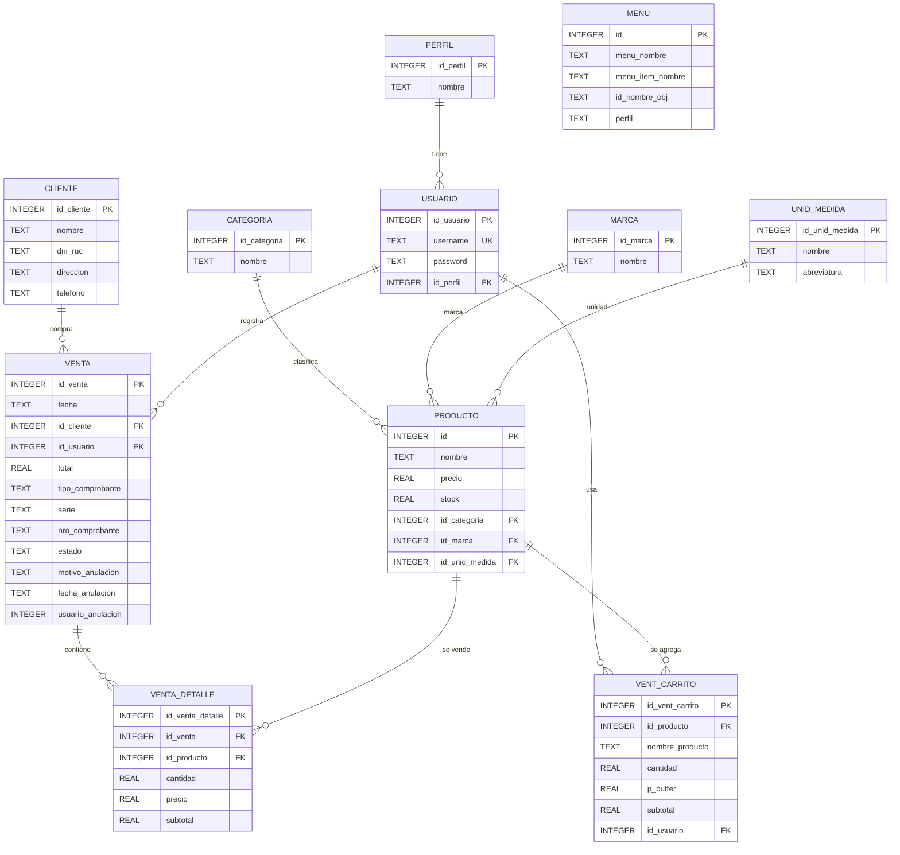
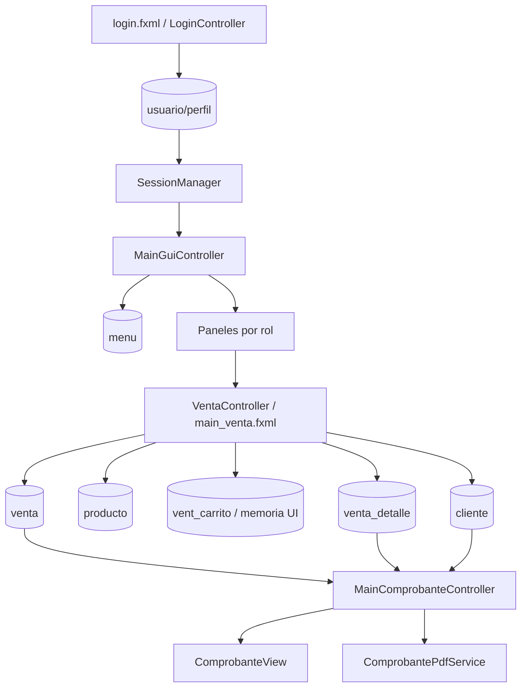

# SQLite Architect - Sys.Ventas (Nueva arquitectura equivalente)

> **Nota importante:** la BD activa del proyecto es **PostgreSQL/Neon** (`schema_neon.sql`).  
> Este documento presenta la **arquitectura equivalente en SQLite** para documentación, portabilidad y estudio académico.  
> El archivo SQL ejecutable equivalente está en `docs/sqlite_arquitectura.sql`.

## 1) Objetivo de esta arquitectura

Esta base de datos soporta un sistema de ventas de escritorio (JavaFX) con:

- Autenticación por usuario y perfil.
- Menú dinámico por perfil.
- Catálogos de producto (categoría, marca, unidad de medida).
- Gestión de clientes (DNI/RUC, dirección, teléfono).
- Carrito/POS temporal.
- Registro de ventas, detalle de venta, comprobante y anulación con trazabilidad.

## 2) Diagrama ER

## 3) Explicación por tabla (cada cosa)

| Tabla | Qué guarda | Campos clave | Conexión con el sistema |
|---|---|---|---|
| `perfil` | Roles del sistema | `id_perfil`, `nombre` | `usuario.id_perfil` define si es ADMIN o VENDEDOR; el menú se filtra por perfil. |
| `usuario` | Cuentas de login | `id_usuario`, `username`, `password`, `id_perfil` | `LoginController` valida credenciales; `SessionManager` guarda usuario activo; ventas guardan `id_usuario`. |
| `menu` | Opciones de menú por perfil | `menu_nombre`, `menu_item_nombre`, `id_nombre_obj`, `perfil` | `MainGuiController`/`MenuMenuItemDaoImp` leen esta tabla para construir el menú dinámico. |
| `categoria` | Catálogo de categorías | `id_categoria`, `nombre` | `ProductoController` la usa en combo; `producto.id_categoria` referencia esta tabla. |
| `marca` | Catálogo de marcas | `id_marca`, `nombre` | `ProductoController` la usa en combo; `producto.id_marca` referencia esta tabla. |
| `unid_medida` | Catálogo de unidades | `id_unid_medida`, `nombre`, `abreviatura` | `ProductoController` la usa en combo; `producto.id_unid_medida` referencia esta tabla. |
| `producto` | Inventario | `id`, `nombre`, `precio`, `stock`, refs a catálogos | POS lo busca/agrega al carrito; al vender se descuenta stock; detalle guarda `id_producto`. |
| `cliente` | Datos del cliente | `id_cliente`, `nombre`, `dni_ruc`, `direccion`, `telefono` | `VentaController` busca/crea cliente; comprobante muestra nombre, DNI/RUC dinámico y dirección. |
| `vent_carrito` | Carrito temporal POS | `id_producto`, `cantidad`, `p_buffer`, `subtotal`, `id_usuario` | Soporta el proceso previo a confirmar venta (según implementación/uso del módulo POS). |
| `venta` | Cabecera de venta/comprobante | `id_venta`, `fecha`, `id_cliente`, `id_usuario`, `total`, `tipo_comprobante`, `serie`, `nro_comprobante`, `estado`, campos de anulación | `VentaController` la crea; `MainComprobanteController` la lista; anulación cambia estado y guarda auditoría. |
| `venta_detalle` | Ítems vendidos | `id_venta`, `id_producto`, `cantidad`, `precio`, `subtotal` | Se guarda por cada producto vendido; el comprobante reconstruye ítems desde aquí. |

## 4) Flujo de datos (de dónde a dónde)

## 5) Cambios recientes reflejados en esta arquitectura

- **Comprobante muestra DNI o RUC dinámicamente**: usa `cliente.dni_ruc` (8=DNI, 11=RUC) en la capa DTO/UI.
- **Comprobante muestra dirección**: usa `cliente.direccion`.
- **No se agregaron tablas/columnas nuevas** para estos cambios; la arquitectura ya tenía los campos necesarios.
- **Se documentó mejor el flujo** de cómo la venta llega al comprobante y al PDF.

## 6) SQL SQLite equivalente (referencia)

El SQL completo está en `docs/sqlite_arquitectura.sql`. Incluye:

- `PRAGMA foreign_keys = ON;`
- Tablas con `INTEGER PRIMARY KEY AUTOINCREMENT`
- FKs entre tablas
- Índices `idx_producto_nombre`, `idx_cliente_dni`
- Datos iniciales mínimos

## 7) Recomendaciones técnicas

- En producción real usar hash de contraseña (no texto plano).
- Agregar FKs explícitas también en el esquema activo si se desea mayor integridad en BD.
- Considerar tabla `comprobante`/`auditoria` si se requiere trazabilidad fiscal más completa.
- Mantener `schema_neon.sql` y esta arquitectura SQLite sincronizados cuando cambie el modelo.